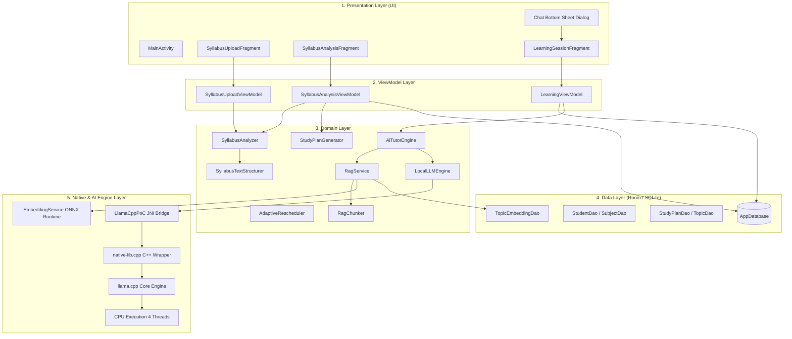

# 02. System Architecture: Daily-Learn

## 1. High-Level Architectural Pattern

Daily-Learn follows the **Clean Architecture** and **MVVM (Model-View-ViewModel)** architectural patterns recommended by Google for modern Android development, augmented by an on-device AI/ML and native C++ inference subsystem.

The architecture is divided into five distinct layers:
1. **Presentation Layer (UI)**: Activities, Fragments, Adapters, and Android Jetpack ViewBinding.
2. **ViewModel Layer**: Jetpack `ViewModel` and `LiveData` coordinating reactive state and UI lifecycle.
3. **Domain Layer**: Pure Java/Android business logic, scheduling algorithms, and AI orchestrators.
4. **Data Layer**: Room SQLite database, Entity models, Data Access Objects (DAOs), and Repositories.
5. **Native / AI Engine Layer**: Embedded ONNX Runtime engine, JNI wrappers, and compiled native C++ `llama.cpp` shared libraries.

---

## 2. Detailed Layer Breakdown

### Layer 1: Presentation Layer
- **`MainActivity`** (`ui/MainActivity.java`): The single-activity host containing the `NavHostFragment`. Coordinates top-level navigation across Onboarding, Home, Plan, Learning, and Profile.
- **`SyllabusUploadFragment`** (`ui/upload/SyllabusUploadFragment.java`): Facilitates file picking (PDF/Image) via Android Storage Access Framework or direct text input.
- **`SyllabusAnalysisFragment`** (`ui/upload/SyllabusAnalysisFragment.java`): Displays real-time parsing progress and presents the structured course syllabus and daily topic allocation for user review.
- **`LearningSessionFragment`** (`ui/learning/LearningSessionFragment.java`): Host for the student's active study session, displaying topic notes, completion toggles, and launching the interactive AI Tutor Bottom Sheet.
- **`ChatAdapter`** (`ui/adapters/ChatAdapter.java`): High-performance `RecyclerView` adapter binding message history directly to `ChatSessionManager` and supporting flicker-free progressive token updates via `appendStreamingToken()`.

### Layer 2: ViewModel Layer
- **`SyllabusUploadViewModel`** (`viewmodel/SyllabusUploadViewModel.java`): Manages document selection state, MIME-type resolution, and asynchronous document parsing.
- **`SyllabusAnalysisViewModel`** (`viewmodel/SyllabusAnalysisViewModel.java`): Drives the parsing lifecycle, progress updates, and orchestrates database transactions to save the generated study plan.
- **`LearningViewModel`** (`viewmodel/LearningViewModel.java`): Exposes LiveData for the active topic, unit metadata, and session progress tracking.

### Layer 3: Domain Layer
- **`SyllabusAnalyzer`** (`domain/ai/SyllabusAnalyzer.java`): Integrates Android `PdfRenderer` and Google ML Kit Text Recognition for OCR, parsing raw text into course information, filtering noise, and distributing topics into calendar day buckets.
- **`SyllabusTextStructurer`** (`domain/parser/SyllabusTextStructurer.java`): Algorithmic regex parser transforming raw curriculum text into a structured tree (`ParsedSubject` -> `ParsedUnit` -> `ParsedTopic`).
- **`StudyPlanGenerator`** (`domain/scheduler/StudyPlanGenerator.java`): Deterministic pure-Java scheduler calculating available study days, reserving an 18% revision window, and interleaving topics across days based on difficulty and time budgets.
- **`AiTutorEngine`** (`domain/ai/AiTutorEngine.java`): Pedagogical AI coordinator combining the student query, retrieved RAG context chunks, and system instructions into a formatted chat template.
- **`RagService`** (`domain/rag/RagService.java`): Facade coordinating chunk generation (`RagChunker`), vector embedding (`EmbeddingService`), and similarity search (`LocalVectorStore`).
- **`LocalLLMEngine`** (`domain/ai/LocalLLMEngine.java`): Lifecycle and state manager for the local language model.

### Layer 4: Data Layer (Room / SQLite)
- **`AppDatabase`** (`data/local/AppDatabase.java`): Room database holding 12 entities with relational foreign keys (`Student`, `Subject`, `Unit`, `Topic`, `Exam`, `StudyPlan`, `StudySession`, `Quiz`, `QuizQuestion`, `QuizResult`, `Progress`, `TopicEmbedding`).
- **DAOs**: `StudentDao`, `SubjectDao`, `StudyPlanDao`, `TopicEmbeddingDao`, `ProgressDao`, `QuizDao`, `ExamDao`.

### Layer 5: Native & AI Engine Layer
- **`EmbeddingService`** (`domain/rag/EmbeddingService.java`): Executes `model.onnx` via `ai.onnxruntime.OrtEnvironment` to generate 384-dimensional vector embeddings.
- **`LlamaCppPoC`** (`domain/ai/LlamaCppPoC.java`): Java Native Interface (JNI) gateway declaring native methods (`initNative`, `generateNative`, `generateStreamingNative`, `releaseNative`).
- **`native-lib.cpp`** (`cpp/native-lib.cpp`): C++ JNI bridge interacting directly with `llama.h` and `ggml`.
- **`llama.cpp`**: Compiled C++ submodule executing GGUF quantized weights on 4 CPU threads.

---

## 3. Threading and Concurrency Model

To guarantee 60 FPS UI performance and avoid Android Application Not Responding (ANR) dialogs, Daily-Learn strictly isolates heavy operations from the main Android UI thread:

| Operation | Executor / Threading Mechanism | Target Thread |
|---|---|---|
| UI Rendering & User Input | Android Main Looper | Main Thread (UI) |
| PDF Rendering & OCR Processing | `Thread` spawn inside `SyllabusAnalyzer` | Background Worker |
| Database Insertions & Queries | `Room` background threads / `ExecutorService` | Background I/O |
| RAG Indexing (`ensureRagIndexed`) | `Executors.newSingleThreadExecutor()` (`aiExecutor`) | Dedicated AI Thread |
| Semantic Vector Search | Background AI Thread | Dedicated AI Thread |
| LLM Tokenization & Sampling | Native C++ POSIX Threads (`n_threads = 4`) | Native CPU Worker Pool |
| Streaming UI Token Updates | `Activity.runOnUiThread()` via JNI callback | Main Thread (UI) |
