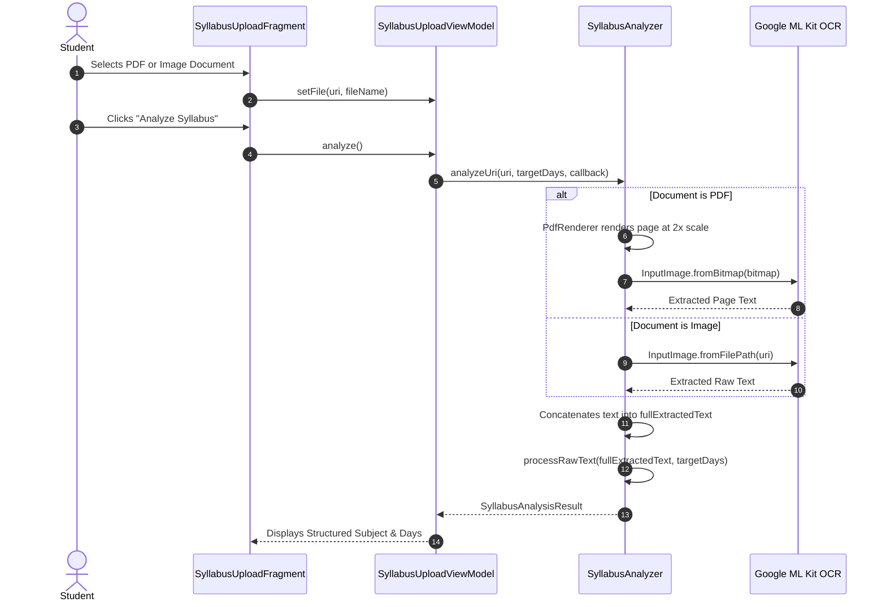
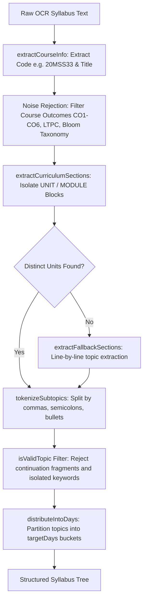
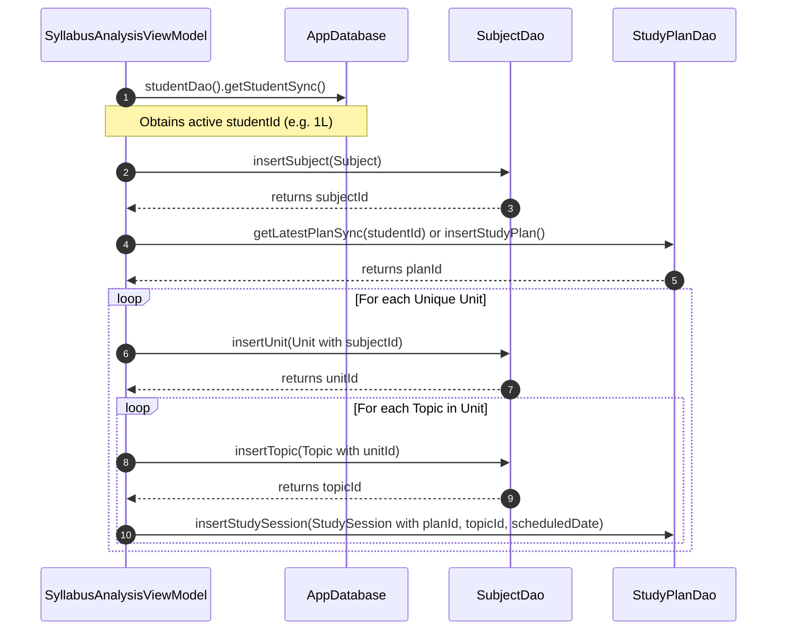
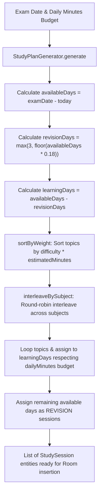
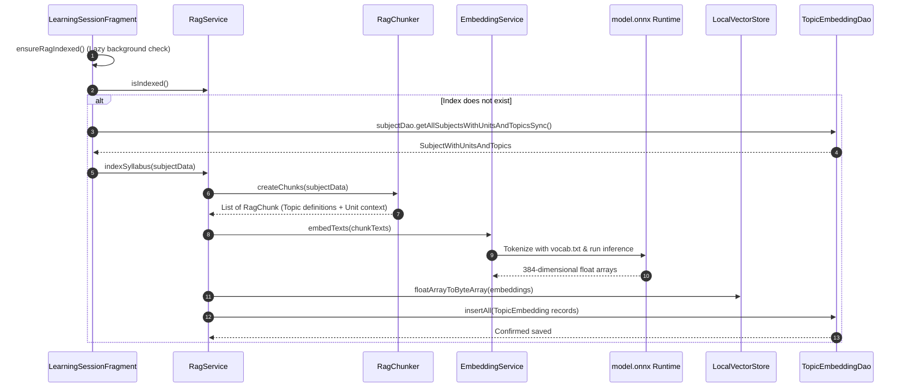
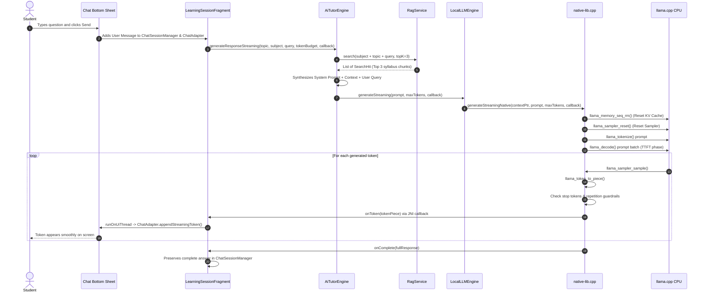

# 03. Complete Data Flow: Daily-Learn

This document provides end-to-end data flow specifications for all primary operations in Daily-Learn, illustrating exact data transformations, protocol boundaries, and storage lifecycles.

---

## Flow A: Syllabus Import & Document Reading

**Data Transferred**:
- Input: Android content `Uri` (`content://media/...`).
- Intermediate: Scaled in-memory Android `Bitmap` (ARGB_8888) rendered at 2x resolution.
- Output: `SyllabusAnalysisResult` containing Course Name, Course Code, and `List<DailyTopicGroup>`.

---

## Flow B: Deterministic Syllabus Cleansing & Parsing

**Key Data Transitions**:
1. `rawText`: Unstructured string containing header boilerplate, faculty names, and OCR artifacts.
2. `sections`: List of `RawSection` holding unit headers (e.g. *"UNIT I: LINEAR DATA STRUCTURES"*) and clean curricular text.
3. `allTopics`: Flat list of validated `ExtractedTopicItem` objects.
4. `dailyGroups`: List of `DailyTopicGroup` mapped across `Day 1` through `Day N`.

---

## Flow C: Relational Database Persistence Flow

**Foreign Key Integrity**:
- `Subject` references `Student(id)` (`ON DELETE CASCADE`).
- `Unit` references `Subject(id)` (`ON DELETE CASCADE`).
- `Topic` references `Unit(id)` (`ON DELETE CASCADE`).
- `StudySession` references `StudyPlan(id)` and `Topic(id)`.

---

## Flow D: Study Plan Generation Flow (Pure Java Scheduler)

---

## Flow E: Semantic RAG Indexing Flow

---

## Flow F & G: Student Question & Local LLM Generation Flow

