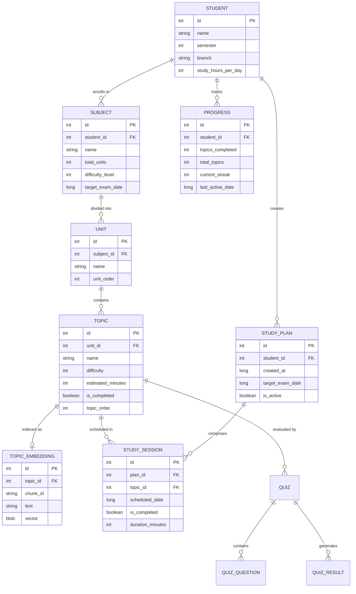

# 05. Database Architecture: Daily-Learn

## 1. Storage Technology: Room & SQLite

Daily-Learn utilizes **Android Room** (built on embedded SQLite) as its persistent object-relational mapping (ORM) layer. Room was chosen because:
1. **Compile-Time SQL Verification**: Query syntax and entity mapping errors are caught at build time rather than crashing at runtime.
2. **Strict Referential Integrity**: Foreign keys with `CASCADE` rules ensure orphaned child records (units, topics, embeddings) are automatically cleaned up.
3. **Zero Network Requirement**: The SQLite database file resides entirely within the app's private internal sandboxed storage directory (`/data/data/com.example.daily_learn/databases/daily_learn_db`).

---

## 2. Entity-Relationship (ER) Diagram



---

## 3. Entity Specifications & Relational Integrity

### 1. `Student` (`data/local/entity/Student.java`)
Represents the local user profile. Root ancestor of all academic records.
- Primary Key: `id` (Auto-generated `int`).
- Fields: `name`, `semester`, `branch`, `study_hours_per_day`.

### 2. `Subject` (`data/local/entity/Subject.java`)
Represents an enrolled academic course.
- Foreign Key: `student_id` references `Student(id)` on delete `CASCADE`.
- Index: `student_id` indexed for fast student-filtered lookups.

### 3. `Unit` (`data/local/entity/Unit.java`)
Represents a curriculum module or unit within a subject.
- Foreign Key: `subject_id` references `Subject(id)` on delete `CASCADE`.
- Index: `subject_id`.

### 4. `Topic` (`data/local/entity/Topic.java`)
Represents an atomic study concept.
- Foreign Key: `unit_id` references `Unit(id)` on delete `CASCADE`.
- Index: `unit_id`.

### 5. `TopicEmbedding` (`data/local/entity/TopicEmbedding.java`)
Represents the vector representation of a topic chunk for semantic RAG search.
- Foreign Key: `topic_id` references `Topic(id)` on delete `CASCADE`.
- Fields: `chunk_id` (`String`), `text` (`String`), `vector` (`byte[]` blob).

### 6. `StudyPlan` & `StudySession` (`data/local/entity/StudyPlan.java`, `StudySession.java`)
Stores the output of `StudyPlanGenerator`. `StudySession` maps a specific `topic_id` to a `scheduled_date` under a parent `plan_id`.

---

## 4. Complex Room Relation Queries

Daily-Learn relies on composite POJOs using Room `@Relation` annotations to retrieve multi-tier hierarchies in a single synchronous query:

### `SubjectWithUnitsAndTopics` (`data/local/entity/SubjectWithUnitsAndTopics.java`)
```java
public class SubjectWithUnitsAndTopics {
    @Embedded
    public Subject subject;

    @Relation(
        entity = Unit.class,
        parentColumn = "id",
        entityColumn = "subject_id"
    )
    public List<UnitWithTopics> units;
}
```
This query structure is leveraged directly by `RagService.indexSyllabus()` and `LearningSessionFragment.ensureRagIndexed()` to ingest an entire course syllabus tree in a single database transaction.

---

## 5. Lessons Learned: Referential Integrity in Tests

During early instrumented testing (`RagInstrumentedTest`), tests failed with an SQLite foreign key constraint violation (`SQLiteConstraintException: FOREIGN KEY constraint failed`).
- **Root Cause**: Mock `Subject` records were inserted with a hardcoded `studentId = 1L` without first creating a matching parent row in the `students` table.
- **Resolution**: Tests were updated to insert a real `Student` record, retrieve its generated primary key, and assign it to child `Subject` entities before cascading insertions. This confirmed that Room foreign key constraints are actively enforced in production.
