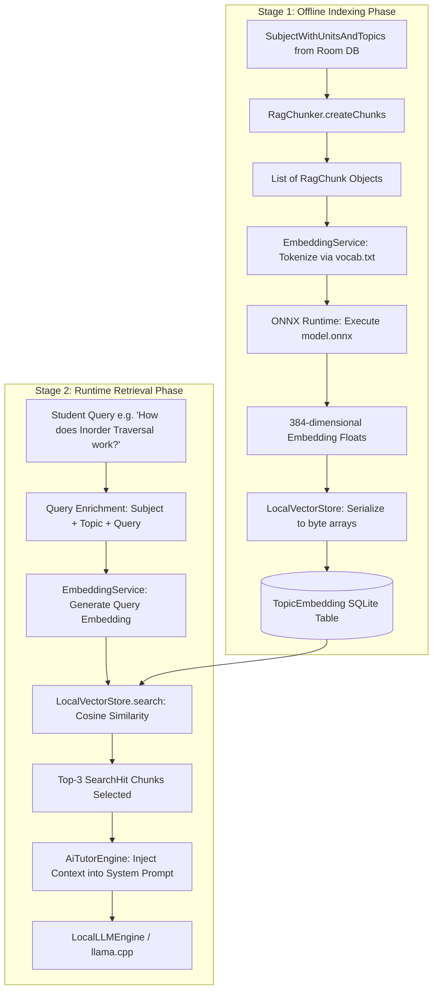

# 06. Retrieval-Augmented Generation (RAG) Architecture

## 1. What is RAG and Why Does Daily-Learn Use It?

**Retrieval-Augmented Generation (RAG)** is an AI architectural pattern that supplements a language model's static knowledge with dynamically retrieved factual context. 

In Daily-Learn, RAG serves three mission-critical functions:
1. **Curriculum Grounding**: Forces the LLM to answer within the strict boundaries of the student's university course syllabus.
2. **Mitigating Hallucination**: Small Language Models (0.5B parameters) running locally on mobile devices have constrained parametric memory. Injecting exact syllabus definitions provides the model with immediate facts, eliminating hallucination.
3. **Preventing Out-of-Scope Bloat**: When asked general questions, the model references the retrieved syllabus topic text to provide course-relevant explanations.

---

## 2. The Complete On-Device RAG Pipeline



---

## 3. Detailed Component Breakdown

### A. Chunking Strategy: `RagChunker` (`domain/rag/RagChunker.java`)
Unlike generic document splitters that cut text every $N$ characters (which cuts sentences in half), `RagChunker` performs **curriculum-aware hierarchical chunking**:
- Iterates over each `UnitWithTopics` in `SubjectWithUnitsAndTopics`.
- For each `Topic`, a discrete `RagChunk` is created.
- Text format:
  ```
  Course: <Subject Name>
  Unit <Order>: <Unit Name>
  Topic: <Topic Name>
  Details: Overview and core concepts of <Topic Name> as prescribed in the academic syllabus.
  ```
- Result: Each chunk encapsulates the exact academic hierarchy of the concept.

### B. Embedding Generation: `EmbeddingService` (`domain/rag/EmbeddingService.java`)
- **Engine**: Microsoft ONNX Runtime (`ai.onnxruntime.OrtEnvironment`) running locally on Android.
- **Model Asset**: `app/src/main/assets/model.onnx` (86.2 MB / 90,445,823 bytes) ? an optimized, quantized MiniLM-L6-v2 transformer model.
- **Tokenizer**: `BertTokenizer` (`domain/rag/BertTokenizer.java`) utilizing `app/src/main/assets/vocab.txt` (226 KB / 231,508 bytes).
- **Output Vector**: A 384-dimensional dense float vector (`float[384]`).
- **Batch Processing**: Supports `embedTexts(String[])` for high-throughput multi-chunk indexing during initial syllabus onboarding.

### C. Vector Store: `LocalVectorStore` (`domain/rag/LocalVectorStore.java`)
Daily-Learn does not rely on heavy external vector databases (such as Faiss, Chroma, or Milvus). Instead, it implements an embedded SQLite vector store:
- Vectors are stored in Room table `topic_embeddings` as binary blobs (`byte[]`) using little-endian `ByteBuffer` serialization.
- **Similarity Search**: Performs in-memory dot product / cosine similarity over normalized embedding vectors:
  $$	ext{Score} = \sum_{i=1}^{384} q_i \cdot c_i$$
- Results are ranked in descending order, returning the top $K$ matches as `SearchHit` instances.

---

## 4. Production Lifecycle: Lazy Indexing

In early prototypes, `RagService.indexSyllabus()` had no automated production caller. This was resolved in `LearningSessionFragment.java`:

- **Method**: `ensureRagIndexed()`
- **Invocation**: Triggered in `onViewCreated()` on a background worker thread (`aiExecutor.execute(...)`).
- **Guarded Execution**: Calls `ragService.isIndexed()`. If embeddings already exist, indexing is skipped immediately.
- **Graceful Degradation**: Wrapped in a comprehensive `try/catch` block. If ONNX initialization fails or the device is out of memory, the exception is logged as a warning; the chat UI remains functional, falling back to basic course metadata prompts without crashing.
