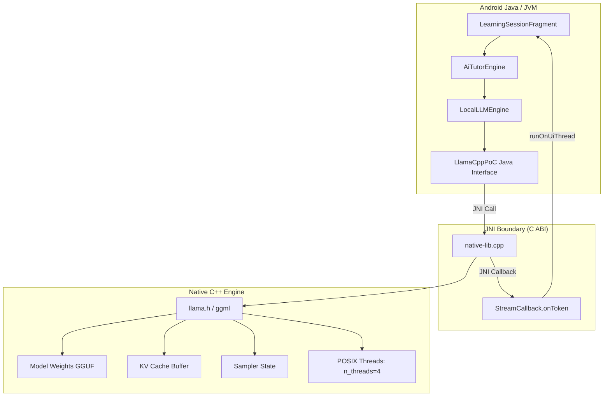

# 07. Local LLM & JNI Architecture

## 1. Why llama.cpp and GGUF?

To achieve true offline AI execution on standard consumer mobile devices without relying on high-end flagship cloud servers, Daily-Learn integrates **`llama.cpp`**:
1. **Zero External Dependencies**: Pure C/C++ implementation with no Python, PyTorch, or CUDA dependencies.
2. **Advanced Quantization (GGUF)**: Runs 4-bit quantized Small Language Models (e.g., Q4_K_M) that reduce memory consumption to ~250MB?500MB, fitting comfortably in mobile RAM.
3. **ARM NEON & DotProd Acceleration**: Leverages modern mobile ARM CPU vector instruction sets for fast floating-point matrix multiplications.

---

## 2. JNI Native Bridge Architecture



### Key Native Functions in `native-lib.cpp` (`app/src/main/cpp/native-lib.cpp`)

1. **Model Loading & Context Initialization**:
   `Java_com_example_daily_1learn_domain_ai_LlamaCppPoC_initNative`
   - Allocates `llama_context_params` with `n_ctx = 2048`, `n_batch = 512`, `n_ubatch = 512`.
   - Sets thread pool:
     ```cpp
     int n_threads = (g_n_threads_override > 0) ? g_n_threads_override : 4;
     cparams.n_threads = n_threads;
     cparams.n_threads_batch = n_threads;
     ```

2. **Sequential KV Cache & Sampler Reset**:
   Before every inference turn, the memory sequence is purged and the sampler chain is reset:
   ```cpp
   llama_memory_t mem = llama_get_memory(wrapper->ctx);
   if (mem != nullptr) {
       llama_memory_seq_rm(mem, -1, -1, -1);
   }
   llama_sampler_reset(wrapper->smpl);
   ```
   **Significance**: This guarantees that question $N+1$ is never contaminated by the leftover KV cache of question $N$.

3. **Progressive Streaming Inference**:
   `Java_com_example_daily_1learn_domain_ai_LlamaCppPoC_generateStreamingNative`
   - Tokenizes the input prompt using `llama_tokenize()`.
   - Decodes prompt batch into context (calculating Time-To-First-Token).
   - Enters generation loop: samples token via `llama_sampler_sample()`, converts to string piece via `llama_token_to_piece()`, checks stop tokens (`<|im_end|>`, `<|eot_id|>`), evaluates repetition guardrails, and invokes Java callback `onToken()`.

---

## 3. Hardware Acceleration Status

- **Current Production Configuration**: **CPU-Only Inference (`n_threads = 4`)**.
- **GPU / Vulkan Status**: Although CMake scripts support optional Vulkan compilation flags (`GGML_USE_VULKAN`), Vulkan acceleration is **NOT** part of the production POC. Extensive testing on the physical test device (OPPO CPH2119 / MediaTek Helio P95 with PowerVR GM9446 GPU) demonstrated that OpenCL/Vulkan drivers on this chipset exhibit driver incompatibilities. CPU inference with 4 threads is the verified, stable production default.
