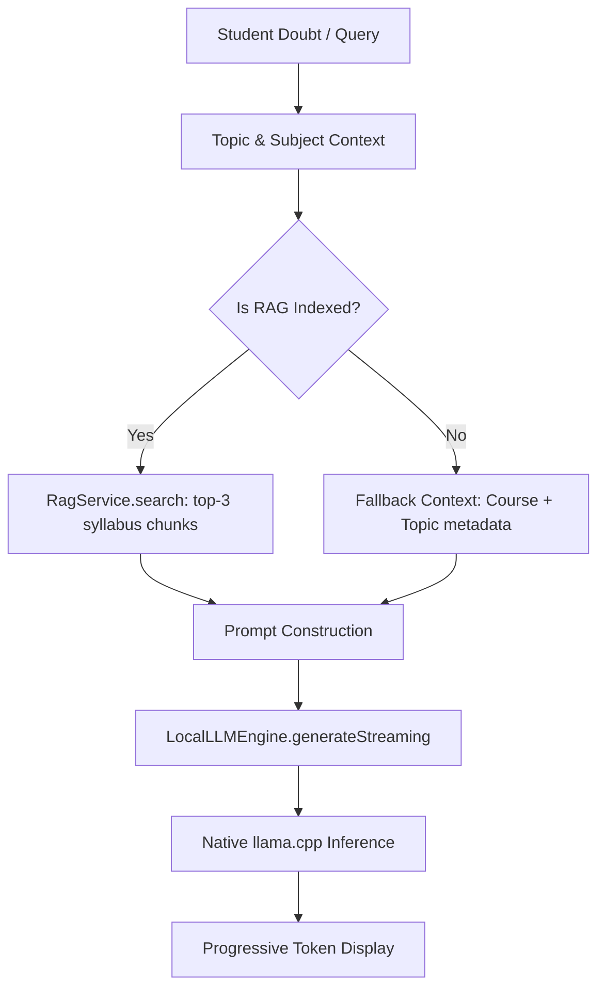

# 08. AI Tutor Engine Logic

## 1. Architectural Role of `AiTutorEngine`

`AiTutorEngine` (`domain/ai/AiTutorEngine.java`) is the central orchestrator responsible for synthesizing pedagogical responses. It acts as the intermediary between the student's conversational intent, the local RAG knowledge base, and the native LLM engine.



---

## 2. Prompt Construction Specification

`AiTutorEngine.generateResponseStreaming()` constructs an immutable ChatML-style instruction prompt designed for Small Language Models:

```
<|im_start|>system
You are an expert, helpful AI study tutor for the course: <Course Name>.
The current lesson topic is: <Topic Name>.
Answer questions and provide examples strictly relevant to <Course Name>. Do NOT mix in other subjects.
Provide detailed, comprehensive, and well-explained answers with examples. Conclude thoughts clearly.
CONTEXT:
<Retrieved RAG Chunk 1>
<Retrieved RAG Chunk 2>
<Retrieved RAG Chunk 3>
<|im_end|>
<|im_start|>user
<Student Query>
<|im_end|>
<|im_start|>assistant
```

### Why This Format Matters:
1. **Negative Prompting**: Explicitly commands *"Do NOT mix in other subjects"* to prevent small models from wandering into unrelated domains.
2. **Pedagogical Persona**: Sets the role of an academic tutor rather than an open-ended generic chatbot.
3. **Structured Stop Sequences**: Standard ChatML delimiters (`<|im_start|>`, `<|im_end|>`) allow native C++ code to reliably catch generation boundaries.

---

## 3. Quick Doubt Explanations (Chips)

To accelerate student interactions, the UI offers three pre-engineered prompt chips:
- **?? Analogy**: Prompts the tutor to explain the concept using a real-world everyday metaphor.
- **?? Code Example**: Requests a clean, commented implementation in Python or C++.
- **? Complexity**: Prompts the model for asymptotic Big-O time and space complexity breakdowns.
