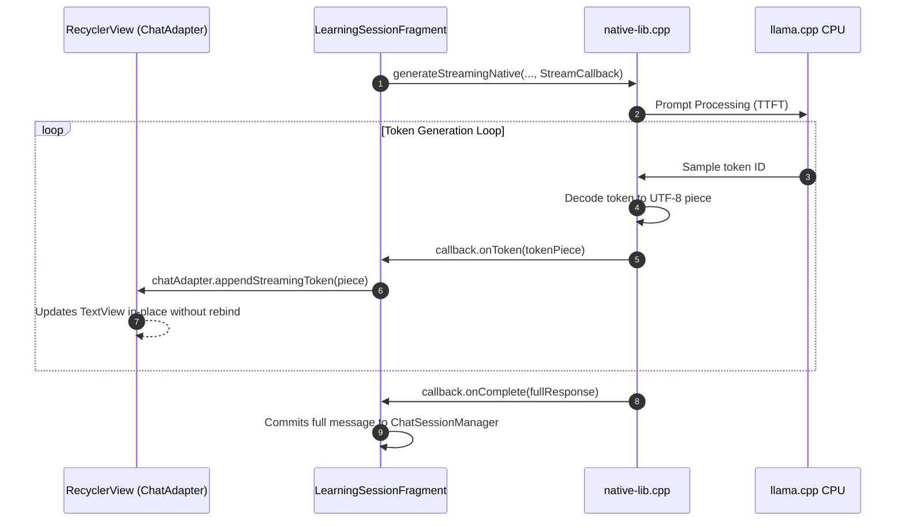

# 10. Streaming & State Management

## 1. The Need for Progressive Token Streaming

Small Language Models running on mobile CPU hardware typically generate between 10 to 18 tokens per second, with an initial **Time-To-First-Token (TTFT)** of 1.5 to 2.5 seconds.

If an application waits for the entire 300-word explanation to complete before displaying text:
- The student experiences 15 to 25 seconds of an unresponsive loading spinner.
- Perceived application latency is extremely high.

By implementing token-by-token streaming via native JNI callbacks, the student sees words appear immediately after the TTFT phase (~1.8s), creating an interactive, engaging conversational experience.

---

## 2. Streaming Architecture & JNI Callbacks



### High-Performance In-Place UI Updates (`ChatAdapter.java`)
In traditional `RecyclerView` implementations, updating a list item requires calling `notifyItemChanged()`, which triggers a full layout rebind and causes visible text flickering.

`ChatAdapter` eliminates this flicker via `appendStreamingToken()`:
```java
public void appendStreamingToken(RecyclerView rv, int index, String token) {
    if (rv == null) return;
    RecyclerView.ViewHolder vh = rv.findViewHolderForAdapterPosition(index);
    if (vh instanceof BotViewHolder) {
        BotViewHolder bvh = (BotViewHolder) vh;
        bvh.tvMessage.append(token);
    }
}
```
This updates the active `TextView` directly on the screen while maintaining the backing model in sync.

---

## 3. Session State Persistence (`ChatSessionManager.java`)

To prevent chat loss when the student closes the AI Tutor Bottom Sheet to inspect topic notes or take a quiz:
- **`ChatSessionManager`** maintains an in-memory process-scoped cache:
  ```java
  private final Map<String, List<ChatMessage>> topicHistories = new ConcurrentHashMap<>();
  ```
- Chat history persists across sheet openings and closures for the entire app session until the user exits the application.
- When reopening the chat sheet, the adapter binds to the persistent list and auto-scrolls to the latest message.
