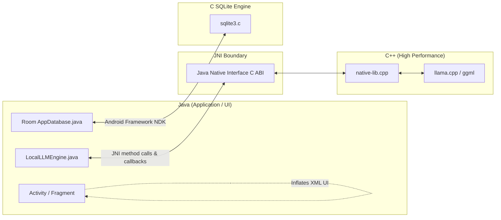

# 13. Programming Languages & Interoperability

## 1. Programming Languages Utilized

Daily-Learn integrates five distinct programming and domain-specific languages:

1. **Java (JDK 17)**: The primary application language governing all Android components (Activities, Fragments, ViewModels, Repositories, DAOs, and pure-Java domain schedulers).
2. **C++ (C++17 Standard)**: The performance-critical native language running `llama.cpp` and `native-lib.cpp`.
3. **SQL (SQLite Dialect)**: Declarative database definition language managed via Android Room annotations (`@Query`, `@Entity`, `@ForeignKey`).
4. **CMake Scripting**: Build configuration language governing native C++ compilation, compiler flags (`-O3`, `-DNDEBUG`), and shared library linkage.
5. **Gradle Kotlin DSL (`.gradle.kts`)**: Build configuration script for dependency management, NDK flags, and packaging.
6. **XML**: Declarative user interface layouts (`res/layout/*.xml`) and Android application manifest declarations.

---

## 2. Language Communication Boundaries

### Communication Protocol 1: Java to C++ (JNI)
- **Invocation**: Java calls `generateStreamingNative()` in `LlamaCppPoC.java`.
- **Translation**: The JVM transitions into the native execution stack. JNI converts Java strings (`jstring`) into C character arrays (`const char*`) using `GetStringUTFChars()`.
- **Callback**: As tokens are sampled in C++, JNI obtains the method ID for `StreamCallback.onToken()` and invokes it back into the JVM, passing individual token strings to the main thread.

### Communication Protocol 2: Java to SQLite (Room)
- **Annotation Processing**: At compile time, Room's annotation processor (`room-compiler`) inspects Java entity models (`Subject.java`, `Topic.java`) and generates Java DAO implementation classes (`SubjectDao_Impl.java`) that construct native SQLite queries executed via Android's native SQLite C driver.
