# 14. Performance & Hardware Benchmarking

## 1. Physical Test Environment

All performance benchmarks documented for Daily-Learn were conducted directly on the target physical Android test device:
- **Device Model**: OPPO CPH2119 (OPPO F17 Pro)
- **ADB Serial**: `S4PBC67585CQZTNJ`
- **SoC**: MediaTek Helio P95 (MT6779V)
- **CPU Architecture**: 64-bit ARMv8.2-A (DynamIQ big.LITTLE)
  - **2x Big Cores**: ARM Cortex-A75 @ 2.20 GHz
  - **6x Little Cores**: ARM Cortex-A55 @ 2.00 GHz
- **RAM**: 8.0 GB LPDDR4X
- **GPU**: PowerVR GM9446
- **Operating System**: Android 12 (ColorOS 12 / API 31)

---

## 2. The CPU Threading Investigation: 4 Threads vs. 8 Threads

During Phase 5.3 native benchmarking (`LlamaCppPerfBench.java`), an unexpected performance inversion was discovered when comparing 4 threads against 8 threads:

| Configuration | Thread Count | Measured Throughput (Excl. TTFT) | TTFT (Time-To-First-Token) | Observations / Thermal Behavior |
|---|---|---|---|---|
| **Optimized CPU4** | **4 Threads** | **~17.79 tokens/sec** | **~1,867 ms** | **Production Default**: Clean, stable generation; low thermal footprint. |
| **Optimized CPU8** | **8 Threads** | **~3.93 ? 3.94 tokens/sec** | **~2,450 ms** | Severe 4.5x throughput collapse; high core contention. |

```mermaid
gantt
    title Token Generation Throughput (Tokens per Second - Higher is Better)
    dateFormat X
    axisFormat %s tok/s
    section 4 Threads (CPU4)
    Optimized Production Default : 0, 18
    section 8 Threads (CPU8)
    Oversaturated Thread Pool   : 0, 4
```

### Architectural Analysis (Why 4 Threads Beat 8 Threads):
1. **big.LITTLE Asymmetry & Thread Migration**:
   The Helio P95 has only 2 fast Cortex-A75 cores and 6 slower Cortex-A55 efficiency cores. When GGML spawns 8 threads, all 8 cores are saturated. In matrix multiplication, a parallel barrier waits for the slowest thread. The Cortex-A55 cores become severe bottlenecks.
2. **Synchronization Overhead & Lock Contention**:
   Spinlocks and thread wakeups across 8 threads across cluster boundaries incur high cache-coherency overhead in the L3 cache.
3. **Evidence-Based Engineering**:
   Running with `n_threads = 4` allows the Linux scheduler to pin compute-intensive threads across the 2 high-performance A75 cores and 2 responsive A55 cores without thrashing all efficiency cores.
4. **Clarification on Cause**:
   These findings are consistent with DynamIQ scheduling and core topology constraints; no formal hardware kernel tracing is claimed beyond the observed logs.

---

## 3. PocketPal Parity Clarification

- **Model Discrepancy**: The historical benchmark harness utilized a cached `SmolLM2-360M` / `Qwen2.5-0.5B` GGUF model (~258 MB), whereas third-party benchmarks like PocketPal often evaluate 500M or 1B models.
- **Hardware Discrepancy**: PocketPal utilizes GPU OpenCL acceleration on Qualcomm Snapdragon (Adreno) platforms. On the MediaTek Helio P95 PowerVR GPU, OpenCL tensor operations are unavailable or unstable. Daily-Learn therefore relies on optimized CPU inference.
- **Conclusion**: Daily-Learn demonstrates CPU configuration parity, proving that 4-thread CPU execution delivers interactive token streaming (>11-17 tok/s) on consumer hardware.
