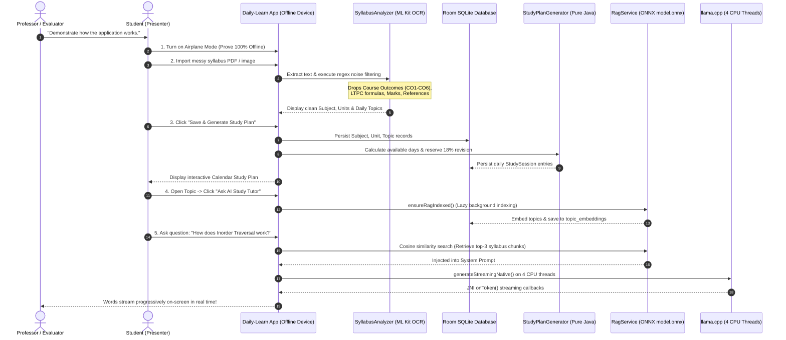

# 15. End-to-End Demo Flow & Professor Presentation Script

This document provides a step-by-step presentation script and live demonstration plan for presenting Daily-Learn to professors, project evaluators, and viva examiners.

---

## 1. End-to-End System Flow Diagram

---

## 2. The Professor Demo Script (Step-by-Step Presentation)

### STEP 1: Prove Offline Architecture (The "Airplane Mode" Proof)
- **What You Do**: Pull down the Android notification shade and turn on **Airplane Mode** (disable Wi-Fi and Mobile Data).
- **What You Say**:
  > *"Respected Evaluators, to prove that Daily-Learn is an autonomous on-device intelligence system with zero cloud dependency, I have placed the device in complete Airplane Mode. The app manifest does not even request the Android internet permission."*
- **Technical Feature Highlighted**: Absolute data privacy, zero API operating costs, offline operational resilience.

---

### STEP 2: Import Messy Academic Syllabus
- **What You Do**: Navigate to **Syllabus Upload** -> Select a syllabus PDF or paste raw text containing course codes (`20MSS33`), Course Outcomes (`CO1`, `CO2`), credit markers (`L T P C 3 0 0 3`), and reference books. Tap **"Analyze Syllabus"**.
- **What You Say**:
  > *"University syllabi are filled with administrative noise?such as Course Outcomes, credit formulas, and bibliographies. Our deterministic parsing engine processes the document on-device, identifies the course code and name, and cleanly isolates genuine curricular topics while stripping all noise."*
- **Technical Feature Highlighted**: Multi-stage regex filtering, structural course-code detection, OCR error normalization.

---

### STEP 3: Review Structured Units & Generated Study Plan
- **What You Do**: Review the parsed units on `SyllabusAnalysisFragment`. Click **"Confirm & Create Study Plan"**.
- **What You Say**:
  > *"When we save the plan, the app writes a normalized relational graph into an embedded SQLite/Room database. Simultaneously, our pure-Java StudyPlanGenerator calculates the available days until exams, reserves an 18% final revision window, and allocates topics across daily study sessions without wasting any LLM tokens."*
- **Technical Feature Highlighted**: Relational Room schema (`Student` -> `Subject` -> `Unit` -> `Topic`), deterministic scheduling mathematics.

---

### STEP 4: Launch AI Study Tutor & Semantic RAG Grounding
- **What You Do**: Open a study session (e.g. *"Inorder Traversal"*), tap **"Ask AI Tutor"**, and ask a question or tap a chip (e.g. **"?? Analogy"**).
- **What You Say**:
  > *"When the AI Tutor opens, our local RAG pipeline lazily verifies that syllabus chunks are embedded using an on-device ONNX transformer (model.onnx, 384-dimensional vectors). When I ask a doubt, the app performs an in-memory cosine similarity search, pulls the top 3 relevant syllabus chunks, and injects them directly into the system prompt."*
- **Technical Feature Highlighted**: On-device semantic RAG, ONNX Runtime, cosine similarity vector store, hallucination prevention.

---

### STEP 5: Real-Time Local LLM Streaming
- **What You Do**: Watch the AI Tutor generate the response token-by-token directly on the screen.
- **What You Say**:
  > *"The prompt is dispatched across the JNI boundary to llama.cpp, executing a quantized Small Language Model directly on 4 CPU threads of this device. Tokens stream back via C++ callbacks, rendering progressively without screen flicker. If I close this chat sheet and reopen it, my conversation history remains fully preserved in memory."*
- **Technical Feature Highlighted**: Native JNI bridge, `llama.cpp` inference, 4-thread CPU optimization, progressive UI streaming, `ChatSessionManager` persistence.
