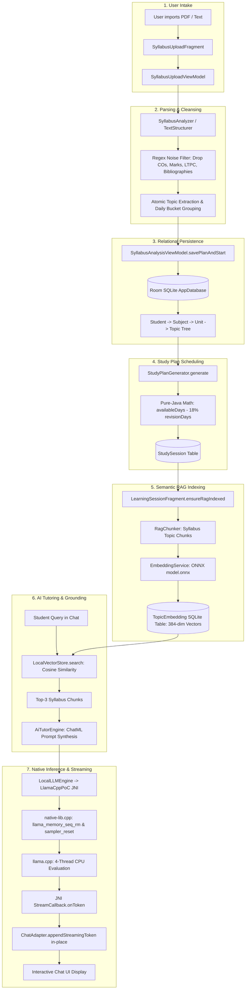

# 18. Complete Technical Flow (A-to-Z Master Architecture)

This document serves as the master engineering reference for Daily-Learn, detailing every operational transition from the user's physical screen touch to the hardware execution on the mobile processor.

---

## 1. The Unified End-to-End Pipeline

---

## 2. Exhaustive Step-by-Step Technical Analysis

### Step 1: Ingestion & Rendering
- **Trigger**: User picks a document in `SyllabusUploadFragment`.
- **Implementation**: If a PDF is selected, `SyllabusAnalyzer` invokes Android's `PdfRenderer`, opening each page and rendering it onto an in-memory `Bitmap` at 2x resolution (ARGB_8888) to maximize character edge definition.

### Step 2: Optical Character Recognition (OCR)
- **Engine**: Google ML Kit on-device Text Recognition (`TextRecognition.getClient()`).
- **Processing**: The bitmap is wrapped into an `InputImage` and processed via `Tasks.await()`.
- **Output**: Raw string buffer preserving positional line breaks.

### Step 3: Deterministic Filtering & Cleansing
- **Engine**: `SyllabusAnalyzer.processRawText()` & `SyllabusTextStructurer`.
- **Filters**:
  - `COURSE_CODE_LINE`: Extracts alphanumeric course code (`20MSS33`) and title.
  - `CO_CODE_PATTERN`: Strips Course Outcomes (`CO1`, `Col`, `C02`, `COS`).
  - `TAIL_MARKERS`: Truncates references, textbooks, and evaluation schemes.
  - `CONTINUATION_STARTERS`: Drops broken OCR continuation fragments.

### Step 4: Relational Persistence
- **Engine**: Android Room ORM (`AppDatabase.java`).
- **Transactions**: `SyllabusAnalysisViewModel.savePlanAndStart()` runs an asynchronous worker thread inserting `Subject`, `Unit`, `Topic`, `StudyPlan`, and `StudySession` records with cascading foreign keys.

### Step 5: Pure-Java Scheduling
- **Engine**: `StudyPlanGenerator.java`.
- **Logic**: Calculates total available calendar days, reserves max(3, floor(days * 0.18)) revision days, weights topics by difficulty, interleaves subjects, and assigns them across learning days.

### Step 6: Lazy Semantic RAG Indexing
- **Engine**: `RagService.java` & `EmbeddingService.java`.
- **Trigger**: `LearningSessionFragment.ensureRagIndexed()` checks `isIndexed()`.
- **Vectors**: Chunks are processed through `model.onnx` (MiniLM-L6-v2) to yield 384-dimensional dense vectors, serialized into byte blobs, and stored in `topic_embeddings`.

### Step 7: Doubt Retrieval & Context Injection
- **Engine**: `AiTutorEngine.java`.
- **Retrieval**: `LocalVectorStore.search()` computes in-memory dot product similarity against stored syllabus vectors, retrieving top-3 matching chunks.
- **Prompt**: Formats the retrieved context, subject title, topic name, and user doubt into a ChatML template.

### Step 8: Native JNI Inference & Token Streaming
- **Engine**: `native-lib.cpp` and `llama.cpp`.
- **State Reset**: `llama_memory_seq_rm()` clears KV cache; `llama_sampler_reset()` resets sampler.
- **Inference**: Tokenizes prompt, decodes batch, and iteratively samples output tokens on 4 CPU threads.
- **UI Update**: Each token piece is forwarded via JNI to `StreamCallback.onToken()`, posting to `runOnUiThread()` where `ChatAdapter.appendStreamingToken()` appends text in-place without triggering layout rebinds.
