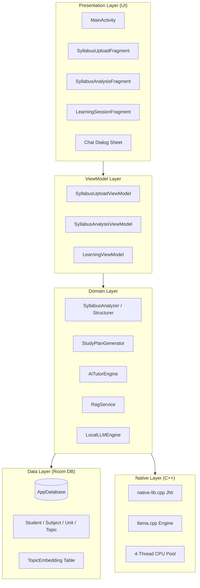
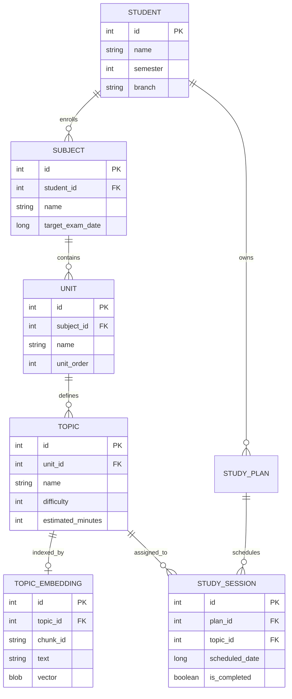
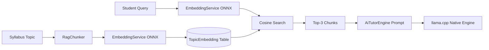
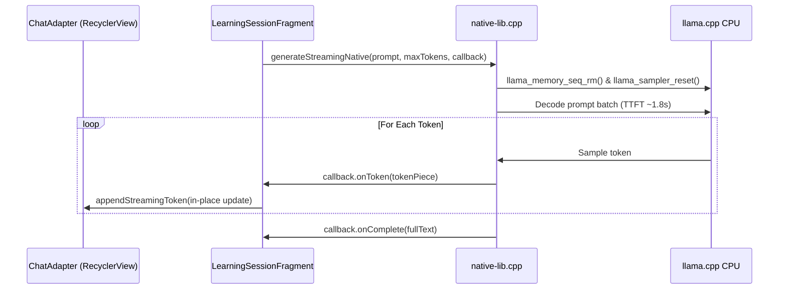
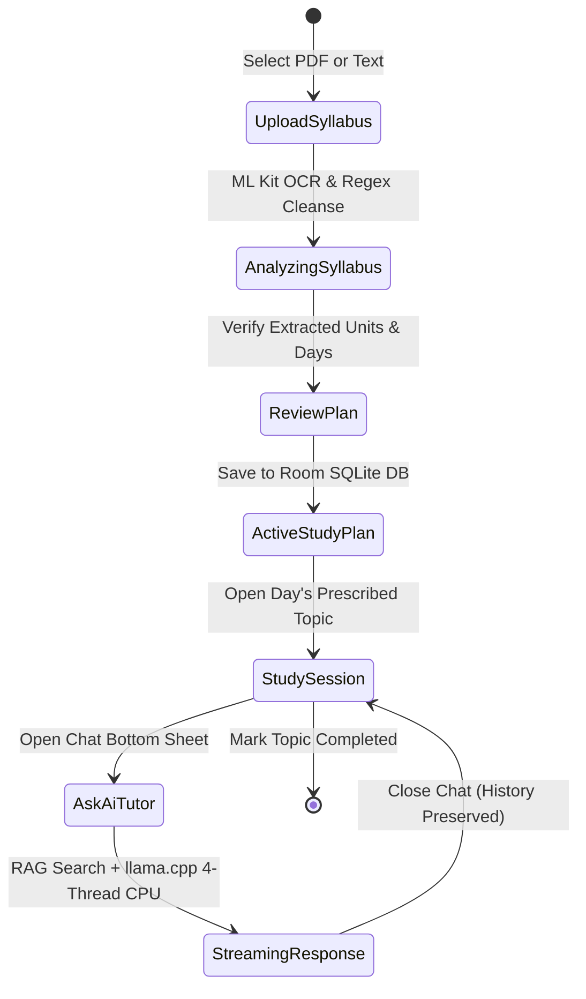

# 20. Complete System Mermaid Diagrams Collection

This document compiles all architectural, behavioral, and relational Mermaid diagrams for Daily-Learn in standard markdown syntax.

---

### Diagram 1: High-Level Clean Architecture

---

### Diagram 2: Complete Relational Database ER Diagram

---

### Diagram 3: Local RAG Pipeline Flow

---

### Diagram 4: Native JNI Streaming Sequence

---

### Diagram 5: End-to-End User Experience Journey

